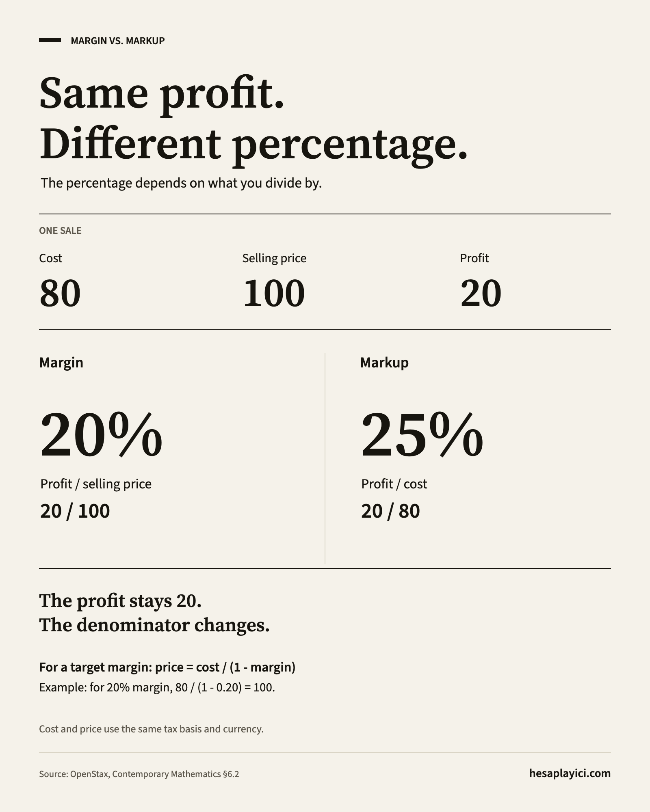

# Financial Math Cheat Sheet

Everyday formulas for percentages, pricing, interest and investment returns. Each calculation comes with a worked example and the assumption most likely to trip you up.

**English** · [Türkçe](README.tr.md)

## Downloads

| Resource                            | Formats                                                                                        |
| ----------------------------------- | ---------------------------------------------------------------------------------------------- |
| Printable quick reference - 2 pages | [A4 PDF](print/financial-math.en.a4.pdf) · [US Letter PDF](print/financial-math.en.letter.pdf) |
| Margin vs. markup graphic           | [PNG, 1600 × 2000](images/margin-vs-markup.en.png) · [SVG](images/margin-vs-markup.en.svg)     |

The PDFs are compact summaries. Choose the matching paper size and print at 100% / actual size. Each file uses selectable text and a grayscale-friendly layout.

<details>
<summary>Preview: margin vs. markup</summary>



</details>

## Before you calculate

- Use decimal rates inside formulas: `12% = 0.12`.
- Match the periods: an annual rate needs time in years; a monthly rate needs months.
- Examples use arbitrary currency units. Keep the same currency throughout a calculation.
- Round the final result. Intermediate rounding can change the answer.
- The examples are simplified: taxes, fees and extra cash flows are included only when explicitly stated.

## Quick reference

| You want to find…                | Formula                                             | Jump to                                         |
| -------------------------------- | --------------------------------------------------- | ----------------------------------------------- |
| A percentage of an amount        | `part = amount × p`                                 | [Percentages](#percentages)                     |
| The change from an old value     | `change = (new − old) / old`                        | [Percentage change](#percentage-change)         |
| The price after two discounts    | `price = original × (1 − d₁) × (1 − d₂)`            | [Discounts](#discounts)                         |
| Margin or markup                 | `margin = profit / price`; `markup = profit / cost` | [Margin vs. markup](#margin-vs-markup)          |
| Simple interest                  | `interest = P × r × t`                              | [Simple interest](#simple-interest)             |
| A balance with compound interest | `FV = P × (1 + r/m)^(m × t)`                        | [Compound interest](#compound-interest)         |
| The effective annual rate        | `EAR = (1 + r/m)^m − 1`                             | [Effective annual rate](#effective-annual-rate) |
| Annualized growth                | `CAGR = (end / start)^(1/t) − 1`                    | [CAGR](#cagr)                                   |
| Return after inflation           | `real = (1 + nominal) / (1 + inflation) − 1`        | [Real return](#real-return)                     |
| A fixed loan payment             | `payment = P × i / (1 − (1 + i)^(−N))`              | [Loan payment](#loan-payment)                   |

Rate results in this table are decimals. Multiply by `100` to express them as percentages.

<a id="percentages"></a>

## 1. Percentages

```text
part = amount × p
p = part / amount
```

`p` is the decimal rate. The second formula needs a nonzero amount.

**Example:** `15% of 240 = 240 × 0.15 = 36`. Conversely, `36 / 240 = 0.15 = 15%`.

**Watch out:** A change from `10%` to `12%` is **2 percentage points**, or a **20% relative increase**. These describe different things.

<a id="percentage-change"></a>

## 2. Percentage change

```text
change = (new − old) / old
new = old × (1 + change)
```

Use a positive starting value for the usual price, revenue and balance interpretation. A starting value of zero has no defined percentage change.

**Example:** `80 → 100`: `(100 − 80) / 80 = 0.25 = 25% increase`.

**Watch out:** Reversing the change gives a different percentage: `100 → 80` is a **20% decrease**. A `20%` loss needs a `25%` gain to recover.

<a id="discounts"></a>

## 3. Successive discounts

```text
final price = original price × (1 − d₁) × (1 − d₂)
combined discount = 1 − (1 − d₁) × (1 − d₂)
```

`d₁` and `d₂` are decimal discounts between `0` and `1`. Each discount applies to the remaining price.

**Example:** `200`, then `20%` off, then `10%` off: `200 × 0.80 × 0.90 = 144`. The combined discount is **28%**.

**Watch out:** Adding `20% + 10%` would give `30%`, which is not the combined discount.

<a id="margin-vs-markup"></a>

## 4. Margin vs. markup

```text
profit = selling price − cost
margin = profit / selling price
markup = profit / cost
selling price for a target margin = cost / (1 − margin)
```

Margin uses the **selling price** as its base; markup uses the **cost**. Cost and selling price must be positive; a target margin must be less than `1`.

**Example:** Cost `80`, selling price `100`: profit **20**, margin **20%**, markup **25%**. To earn a `30%` margin on cost `80`, price at `80 / 0.70 ≈ 114.29`.

**Watch out:** This is a product-level margin on the stated cost. It is not a company's net profit margin after all expenses. Compare cost and price on the same tax basis.

<a id="simple-interest"></a>

## 5. Simple interest

```text
interest = P × r × t
final balance = P + interest
```

`P` is principal, `r` is the annual decimal rate, and `t` is time in years. Interest is earned only on the original principal.

**Example:** `1,000` at `12%` a year for `6` months: `1,000 × 0.12 × 0.5 = 60` interest; final balance **1,060**.

**Watch out:** For day-based calculations, use the contract's day-count convention. A year may use `360`, `365`, or actual calendar days.

<a id="compound-interest"></a>

## 6. Compound interest

```text
FV = P × (1 + r/m)^(m × t)
interest earned = FV − P
```

`P` is principal, `r` the nominal annual decimal rate, `m` the number of compounding periods per year, and `t` the time in years.

**Example:** `1,000` at a nominal `12%` a year, compounded monthly for `1` year: `1,000 × (1 + 0.12/12)^12 ≈ 1,126.83`. Interest earned: **126.83**.

**Watch out:** This example has a fixed rate, a whole number of compounding periods, and no deposits or withdrawals. A monthly rate of `1%` is different from a nominal annual rate of `1%`.

<a id="effective-annual-rate"></a>

## 7. Effective annual rate

```text
EAR = (1 + r/m)^m − 1
periodic rate from EAR = (1 + EAR)^(1/m) − 1
```

`r` is a nominal annual decimal rate, `m` the number of compounding periods per year. EAR includes the effect of compounding over a year.

**Example:** Nominal `12%`, compounded monthly: `(1 + 0.12/12)^12 − 1 ≈ 0.126825`, or **12.68% effective annually**.

**Watch out:** EAR here excludes fees. Do not assume an advertised APR, APY or local total-cost measure uses the same definition.

<a id="cagr"></a>

## 8. Compound annual growth rate (CAGR)

```text
CAGR = (ending value / starting value)^(1/t) − 1
```

`t` is the number of years. This form assumes positive starting and ending values, with no contributions or withdrawals during the period.

**Example:** `10,000 → 14,641` in `4` years: `(14,641 / 10,000)^(1/4) − 1 = 0.10`, or **10% per year**.

**Watch out:** CAGR smooths the path between two values. It does not show volatility or mean the investment gained `10%` in each actual year. With additional cash flows, use a suitable cash-flow-aware return measure.

<a id="real-return"></a>

## 9. Inflation-adjusted return

```text
real return = (1 + nominal return) / (1 + inflation) − 1
```

Both rates are decimals covering the **same period** and must be greater than `−1`.

**Example:** Nominal return `15%`, inflation `10%`: `1.15 / 1.10 − 1 ≈ 0.045455`, or **4.55% real return**.

**Watch out:** `15% − 10% = 5%` is an approximation. Dividing the growth factors gives the exact result for these inputs. Use a nominal return that reflects any fees or taxes you intend to include.

<a id="loan-payment"></a>

## 10. Fixed loan payment

```text
payment = P × i / (1 − (1 + i)^(−N))
if i = 0: payment = P / N
```

`P` is principal, `i` the decimal rate **per payment period**, and `N` the number of payments. Payments are equal and made at the end of each period; the final balance is zero.

**Example:** Borrow `10,000` for `12` months at a nominal annual rate of `12%`: `i = 0.12 / 12 = 0.01`, so the monthly payment is **about 888.49**. At `0%`, it is **about 833.33**.

**Watch out:** This is the basic amortization formula. It excludes taxes, fees, insurance and extra payments. An actual schedule rounds payments and may adjust the final payment. Dividing by `12` converts a nominal annual rate; an effective annual rate needs the conversion in section 7.

## Sources

These references explain the underlying mathematics. The worked examples above were prepared for this sheet.

- **Percentages:** [OpenStax — Understanding Percent](https://openstax.org/books/contemporary-mathematics/pages/6-1-understanding-percent).
- **Discounts and pricing:** [OpenStax — Discounts, Markups, and Sales Tax](https://openstax.org/books/contemporary-mathematics/pages/6-2-discounts-markups-and-sales-tax).
- **Simple interest and loan payments:** [OpenStax — Simple Interest](https://openstax.org/books/contemporary-mathematics/pages/6-3-simple-interest).
- **Compound interest and effective yield:** [OpenStax — Compound Interest](https://openstax.org/books/contemporary-mathematics/pages/6-4-compound-interest).
- **Annualized growth:** [OpenStax — Chapter 6 Formula Review](https://openstax.org/books/contemporary-mathematics/pages/6-formula-review).
- **Real return:** [Federal Reserve Bank of St. Louis — Constructing “ex ante” real interest rates on FRED](https://fred.stlouisfed.org/blog/2022/05/constructing-ex-ante-real-interest-rates-on-fred/).

## About and contributions

Prepared by [hesaplayici.com](https://hesaplayici.com/en). Try the [compound interest calculator](https://hesaplayici.com/en/finance/compound-interest-calculator), [margin and markup calculator](https://hesaplayici.com/en/finance/profit-margin-calculator), or [investment return calculator](https://hesaplayici.com/en/finance/investment-return-calculator).

Corrections and clearer examples are welcome. See [CONTRIBUTING.md](CONTRIBUTING.md). Licensed under [MIT](LICENSE).

Embedded Adobe Source fonts retain their SIL Open Font License; see [font notices](images/FONT-LICENSES.txt).
