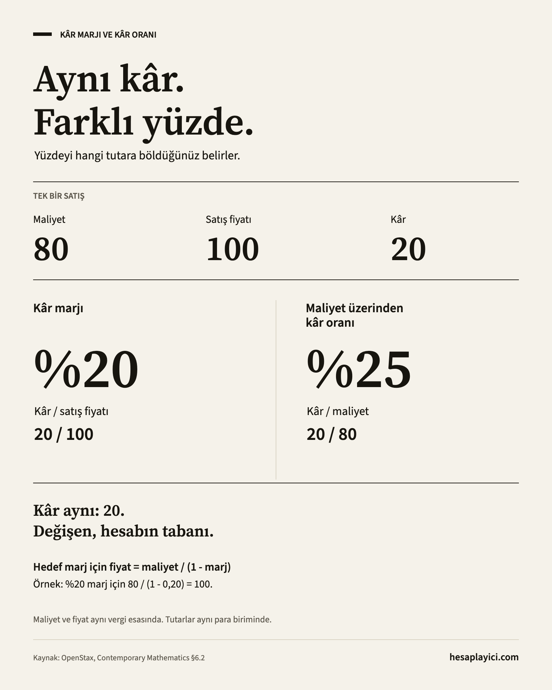

# Finans Matematiği — Hızlı Başvuru

Yüzde, fiyatlandırma, faiz ve yatırım getirisi için günlük hayatta kullanılan formüller. Her hesabın yanında sayısal bir örnek ve sık yapılan bir hataya ilişkin kısa not bulunur.

[English](README.md) · **Türkçe**

## İndirilebilir dosyalar

| Kaynak                                 | Biçimler                                                                                       |
| -------------------------------------- | ---------------------------------------------------------------------------------------------- |
| Yazdırılabilir hızlı başvuru - 2 sayfa | [A4 PDF](print/financial-math.tr.a4.pdf) · [US Letter PDF](print/financial-math.tr.letter.pdf) |
| Kâr marjı ve kâr oranı görseli         | [PNG, 1600 × 2000](images/margin-vs-markup.tr.png) · [SVG](images/margin-vs-markup.tr.svg)     |

PDF'ler kısa özetlerdir. Kâğıdınıza uygun boyutu seçip %100 / gerçek boyutta yazdırın. Her dosyada seçilebilir metin ve gri tonlamaya uygun bir düzen kullanılmıştır.

<details>
<summary>Önizleme: kâr marjı ve kâr oranı</summary>



</details>

## Hesaplamadan önce

- Formüllerde oranları ondalık kullanın: `%12 = 0,12`.
- Dönemleri eşleştirin: yıllık oran için yıl, aylık oran için ay kullanın.
- Örnek tutarlar herhangi bir para biriminde olabilir. Aynı hesap içinde para birimini değiştirmeyin.
- Sonucu en sonda yuvarlayın. Ara adımları yuvarlamak sonucu değiştirebilir.
- Örnekler sadeleştirilmiştir: vergi, masraf ve ek para giriş çıkışları yalnızca açıkça belirtilmişse hesaba dahildir.

## Hızlı başvuru

| Bulmak istediğiniz                         | Formül                                                   | Bölüm                                  |
| ------------------------------------------ | -------------------------------------------------------- | -------------------------------------- |
| Bir tutarın yüzdesi                        | `parça = tutar × p`                                      | [Yüzde](#percentages)                  |
| Eski değere göre değişim                   | `değişim = (yeni − eski) / eski`                         | [Yüzde değişim](#percentage-change)    |
| İki indirimden sonraki fiyat               | `fiyat = ilk fiyat × (1 − d₁) × (1 − d₂)`                | [İndirim](#discounts)                  |
| Kâr marjı veya maliyet üzerinden kâr oranı | `marj = kâr / satış fiyatı`; `kâr oranı = kâr / maliyet` | [Marj ve kâr oranı](#margin-vs-markup) |
| Basit faiz                                 | `faiz = P × r × t`                                       | [Basit faiz](#simple-interest)         |
| Bileşik faizle vade sonu tutarı            | `FV = P × (1 + r/m)^(m × t)`                             | [Bileşik faiz](#compound-interest)     |
| Yıllık efektif faiz oranı                  | `EAR = (1 + r/m)^m − 1`                                  | [Efektif oran](#effective-annual-rate) |
| Yıllık bileşik büyüme                      | `CAGR = (son / ilk)^(1/t) − 1`                           | [CAGR](#cagr)                          |
| Enflasyondan arındırılmış getiri           | `reel = (1 + nominal) / (1 + enflasyon) − 1`             | [Reel getiri](#real-return)            |
| Eşit kredi taksiti                         | `taksit = P × i / (1 − (1 + i)^(−N))`                    | [Kredi taksiti](#loan-payment)         |

Tablodaki oran sonuçları ondalıktır. Yüzde olarak ifade etmek için `100` ile çarpın.

<a id="percentages"></a>

## 1. Yüzde

```text
parça = tutar × p
p = parça / tutar
```

`p`, ondalık orandır. İkinci formülde tutar sıfır olamaz.

**Örnek:** `240'ın %15'i = 240 × 0,15 = 36`. Tersinden, `36 / 240 = 0,15 = %15`.

**Dikkat:** `%10'dan %12'ye` çıkış, **2 yüzde puan** veya **%20 göreli artış** demektir. Bu iki ifade farklı şeyleri anlatır.

<a id="percentage-change"></a>

## 2. Yüzde değişim

```text
değişim = (yeni − eski) / eski
yeni = eski × (1 + değişim)
```

Fiyat, gelir ve bakiye gibi olağan yorumlarda başlangıç değerini pozitif alın. Başlangıç değeri sıfırsa yüzde değişim tanımsızdır.

**Örnek:** `80 → 100`: `(100 − 80) / 80 = 0,25 = %25 artış`.

**Dikkat:** Değişimi tersine çevirdiğinizde oran değişir: `100 → 80`, **%20 azalıştır**. `%20` kaybı telafi etmek için `%25` kazanç gerekir.

<a id="discounts"></a>

## 3. Ardışık indirimler

```text
son fiyat = ilk fiyat × (1 − d₁) × (1 − d₂)
toplam indirim oranı = 1 − (1 − d₁) × (1 − d₂)
```

`d₁` ve `d₂`, `0` ile `1` arasındaki ondalık indirim oranlarıdır. Her indirim, kalan fiyat üzerinden uygulanır.

**Örnek:** `200` tutara önce `%20`, sonra `%10` indirim: `200 × 0,80 × 0,90 = 144`. Toplam indirim **%28** olur.

**Dikkat:** `%20 + %10 = %30` hesabı, ardışık indirimlerin toplamını vermez.

<a id="margin-vs-markup"></a>

## 4. Kâr marjı ve maliyet üzerinden kâr oranı

```text
kâr = satış fiyatı − maliyet
kâr marjı = kâr / satış fiyatı
maliyet üzerinden kâr oranı = kâr / maliyet
hedef marj için satış fiyatı = maliyet / (1 − marj)
```

Marjın tabanı **satış fiyatı**, maliyet üzerinden kâr oranının tabanı **maliyettir**. Maliyet ve satış fiyatı pozitif, hedef marj `1'den` küçük olmalıdır.

**Örnek:** Maliyet `80`, satış fiyatı `100`: kâr **20**, marj **%20**, maliyet üzerinden kâr oranı **%25**. Maliyeti `80` olan üründe `%30` marj için satış fiyatı `80 / 0,70 ≈ 114,29` olmalıdır.

**Dikkat:** Bu hesap, belirtilen maliyete göre ürün düzeyindeki marjı verir. Şirketin bütün giderleri düşüldükten sonraki net kâr marjını vermez. Maliyet ve satış fiyatını aynı vergi esasında karşılaştırın.

<a id="simple-interest"></a>

## 5. Basit faiz

```text
faiz = P × r × t
vade sonu tutarı = P + faiz
```

`P` anapara, `r` yıllık ondalık faiz oranı, `t` yıl cinsinden süredir. Faiz yalnızca ilk anapara üzerinden işler.

**Örnek:** `1.000` anapara, yıllık `%12` oran, `6` ay: `1.000 × 0,12 × 0,5 = 60` faiz; vade sonu tutarı **1.060**.

**Dikkat:** Günle yapılan hesaplarda sözleşmedeki gün sayım yöntemini kullanın. Yıl `360`, `365` veya gerçek takvim günleri üzerinden alınabilir.

<a id="compound-interest"></a>

## 6. Bileşik faiz

```text
FV = P × (1 + r/m)^(m × t)
toplam faiz = FV − P
```

`P` anapara, `r` yıllık nominal ondalık faiz oranı, `m` yıldaki faizlendirme sayısı, `t` yıl cinsinden süredir.

**Örnek:** `1.000` anapara, yıllık nominal `%12` oran, aylık faizlendirme, `1` yıl: `1.000 × (1 + 0,12/12)^12 ≈ 1.126,83`. Toplam faiz: **126,83**.

**Dikkat:** Örnekte oran sabittir, faizlendirme dönemi sayısı tam sayıdır ve arada para yatırılmaz veya çekilmez. Aylık `%1` oran ile yıllık nominal `%1` oran farklıdır.

<a id="effective-annual-rate"></a>

## 7. Yıllık efektif faiz oranı

```text
EAR = (1 + r/m)^m − 1
EAR'dan dönem oranı = (1 + EAR)^(1/m) − 1
```

`r` yıllık nominal ondalık oran, `m` yıldaki faizlendirme sayısıdır. EAR, yıl içindeki bileşikleşmenin etkisini içerir.

**Örnek:** Yıllık nominal `%12`, aylık faizlendirme: `(1 + 0,12/12)^12 − 1 ≈ 0,126825`, yani **yıllık efektif %12,68**.

**Dikkat:** Buradaki EAR masrafları içermez. Bankanın açıkladığı APR, APY veya toplam maliyet ölçüsünün aynı tanımı kullandığını varsaymayın.

<a id="cagr"></a>

## 8. Yıllık bileşik büyüme oranı (CAGR)

```text
CAGR = (son değer / ilk değer)^(1/t) − 1
```

`t`, yıl sayısıdır. Bu biçim, ilk ve son değerin pozitif olduğunu ve dönem içinde ek para yatırılmadığını veya çekilmediğini varsayar.

**Örnek:** `4` yılda `10.000 → 14.641`: `(14.641 / 10.000)^(1/4) − 1 = 0,10`, yani **yıllık %10**.

**Dikkat:** CAGR, başlangıç ile son arasındaki büyümeyi sabit bir yıllık orana indirger. Dalgalanmayı göstermez; her yıl gerçekten `%10` kazanıldığını söylemez. Ek para hareketleri varsa bunları dikkate alan uygun bir getiri ölçüsü kullanın.

<a id="real-return"></a>

## 9. Enflasyondan arındırılmış getiri

```text
reel getiri = (1 + nominal getiri) / (1 + enflasyon) − 1
```

İki oran da ondalık olmalı, **aynı dönemi** kapsamalı ve `−1'den` büyük olmalıdır.

**Örnek:** Nominal getiri `%15`, enflasyon `%10`: `1,15 / 1,10 − 1 ≈ 0,045455`, yani **%4,55 reel getiri**.

**Dikkat:** `%15 − %10 = %5` yaklaşık sonuçtur. Büyüme çarpanlarını bölmek bu girdiler için kesin sonucu verir. Masraf veya vergiyi dahil etmek istiyorsanız nominal getiriyi buna göre alın.

<a id="loan-payment"></a>

## 10. Eşit kredi taksiti

```text
taksit = P × i / (1 − (1 + i)^(−N))
i = 0 ise: taksit = P / N
```

`P` anapara, `i` **taksit dönemi başına** ondalık faiz oranı, `N` taksit sayısıdır. Taksitler eşittir, dönem sonunda ödenir ve son ödeme sonrasında borç sıfırlanır.

**Örnek:** `10.000` borç, `12` ay, yıllık nominal `%12`: `i = 0,12 / 12 = 0,01`, aylık taksit **yaklaşık 888,49**. Faiz `%0` olursa **yaklaşık 833,33**.

**Dikkat:** Bu temel amortisman formülüdür. Vergi, masraf, sigorta ve ek ödemeleri içermez. Gerçek ödeme planı taksitleri yuvarlar ve son taksiti düzeltebilir. Yıllık nominal oran `12'ye` bölünebilir; yıllık efektif oran için 7. bölümdeki dönüşüm gerekir.

## Kaynaklar

Bu kaynaklar hesapların matematiksel temelini açıklar. Yukarıdaki sayısal örnekler bu belge için hazırlanmıştır.

- **Yüzde:** [OpenStax — Understanding Percent](https://openstax.org/books/contemporary-mathematics/pages/6-1-understanding-percent).
- **İndirim ve fiyatlandırma:** [OpenStax — Discounts, Markups, and Sales Tax](https://openstax.org/books/contemporary-mathematics/pages/6-2-discounts-markups-and-sales-tax).
- **Basit faiz ve kredi taksiti:** [OpenStax — Simple Interest](https://openstax.org/books/contemporary-mathematics/pages/6-3-simple-interest).
- **Bileşik faiz ve efektif oran:** [OpenStax — Compound Interest](https://openstax.org/books/contemporary-mathematics/pages/6-4-compound-interest).
- **Yıllık büyüme:** [OpenStax — Chapter 6 Formula Review](https://openstax.org/books/contemporary-mathematics/pages/6-formula-review).
- **Reel getiri:** [Federal Reserve Bank of St. Louis — Constructing “ex ante” real interest rates on FRED](https://fred.stlouisfed.org/blog/2022/05/constructing-ex-ante-real-interest-rates-on-fred/).

## Hakkında ve katkı

[hesaplayici.com](https://hesaplayici.com/) tarafından hazırlanmıştır. [Bileşik faiz](https://hesaplayici.com/finans/bilesik-faiz-hesaplama), [kâr marjı ve kâr oranı](https://hesaplayici.com/finans/kar-marji-hesaplama) veya [yatırım getirisi](https://hesaplayici.com/finans/yatirim-getirisi-hesaplama) hesaplayıcılarını kullanabilirsiniz.

Düzeltme ve daha açık örnek önerilerine açığız. Bkz. [CONTRIBUTING.md](CONTRIBUTING.md). [MIT](LICENSE) lisanslıdır.

Dosyalara gömülü Adobe Source yazı tipleri SIL Open Font License kapsamındadır; bkz. [yazı tipi lisansları](images/FONT-LICENSES.txt).
